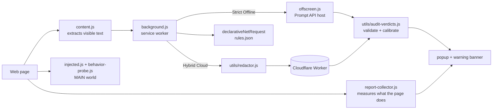

# Dadblock

**Your browser's protective dad.** A free Chrome extension (Manifest V3) that checks pages for scams with AI,
blocks ad networks, trackers and pop-unders, and tells you in plain English what a page is doing.
No account, no ads, nothing sold.

[Chrome Web Store](https://chromewebstore.google.com/detail/dadblock-ai-scam-guard-ad/fofjhnhhfpeglomiolgngkdchgbdkepf) · [Website](https://dadblock.org) · [Case study](https://projectguram.com/dadblock.html) · [Privacy policy](https://dadblock.org/privacy.html)

## What it does

- **Scam check (AI).** Reads the visible text of a page and flags concrete asks: a fee to claim a prize,
  a code handed to a "support agent", a request for a wallet recovery phrase. It always shows the exact quote.
- **Dad's Report.** Which outside sites a page contacts, where a password or card form really sends its data,
  and whether the page asked for notifications, location, camera or clipboard. Every sentence is tied to a measured fact.
- **Shop check.** Looks for the boring things scam shops skip: who runs it, how to contact them, returns, how you can pay.
- **Pop-up bouncer and ad blocking.** Stops pop-unders and invisible click traps (real sign-in and payment windows still open)
  and blocks known ad and tracking networks with a small rule list that can update without an extension release.
- **Honest wording.** Dadblock never says a site is "safe". "No scam wording found" means exactly that, and
  "Page not verified" means it could not tell. AI can be wrong, so the evidence is always shown.

## Privacy model

| Mode | What leaves your browser |
| --- | --- |
| Strict Offline | Nothing. Analysis runs on-device with Chrome's built-in Prompt API. |
| Hybrid Cloud | Only the visible page text and URL, after emails, phone numbers, card numbers, SSN-style numbers and IPv4 addresses are removed **locally** by `extension/utils/redactor.js`. |

Private workspaces (documents, boards, designs) are never scanned. There are no accounts.
Redaction is best-effort pattern matching, covered by tests; see [known limitations](#known-limitations).

## Architecture



More detail and the reasoning behind each choice: [docs/ARCHITECTURE.md](docs/ARCHITECTURE.md).

## Run it yourself

```bash
git clone https://github.com/gugasi/dadblock.git
cd dadblock
```

1. Open `chrome://extensions` and switch on **Developer mode**.
2. Click **Load unpacked** and choose the `extension/` folder.

```bash
npm install
npm run lint
npm test
python3 tests/e2e/load-extension.py   # real Chromium: worker starts, popup renders (needs playwright)
```

## Is this the code in the store?

Yes. The first commit, tagged `v1.1.0`, contains the extension exactly as submitted to the Chrome Web Store.
Later commits only add tests, tooling and documentation (compare with `git diff v1.1.0 HEAD -- extension`).

## How it was built

I built Dadblock myself, with AI coding assistants helping along the way. I read, tested and argued with
everything they produced, and I am responsible for what ships. The tests here exist partly so that you
(and I) do not have to take that on trust.

## Known limitations

- Redaction is pattern-based and tuned for US-style formats; unusual number formats can slip through,
  and long ID-like numbers can be over-redacted. Both are tested and tracked in the [changelog](CHANGELOG.md).
- `background.js` and `content.js` are large and should be split into modules.
- AI analysis can be wrong. Dadblock shows its evidence and leaves the decision to you.
- The cloud service (a Cloudflare Worker) is private and not part of this repository.

## License

Code: [GPL-3.0](LICENSE). The Dadblock name, mascot and icons are not licensed for reuse; see [NOTICE.md](NOTICE.md).
Security reports: [SECURITY.md](SECURITY.md).
